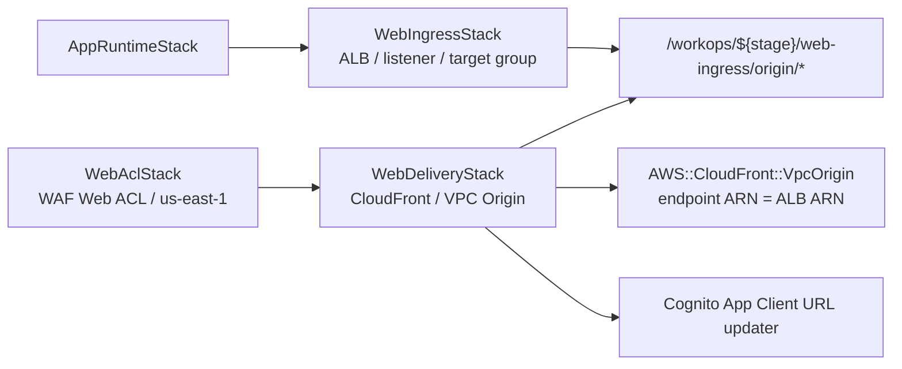
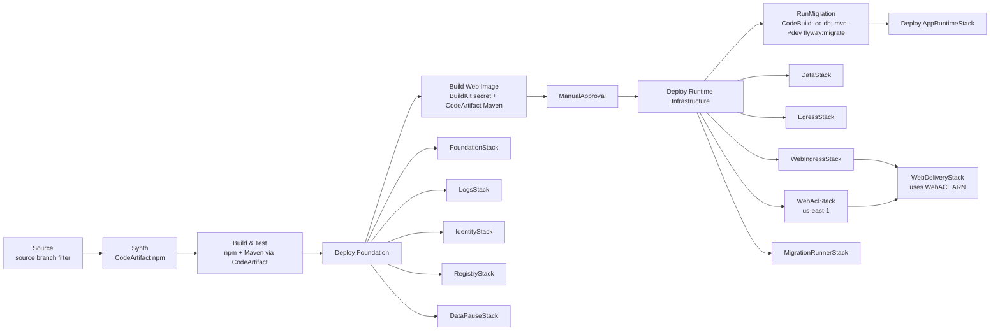

# コード・設計の説明

AWS構成と設計理由、開発中に発生した問題への対応を、実装コードとともに説明します。

[README](../README.md) · [主要機能](key-features.md) · [テスト](testing.md)

## 主要コードの入口

| 領域 | 対応コード |
|---|---|
| 認証・認可 | [SecurityConfig](../apps/web/src/main/java/com/example/workops/common/security/SecurityConfig.java) |
| 申請の状態遷移 | [申請Service](../apps/web/src/main/java/com/example/workops/request/service) |
| 会社境界とSQL | [申請Mapper](../apps/web/src/main/resources/mapper/request/RequestMapper.xml)、[DB定義](database-schema.md)、[DBスキーマ](../db/migration/V1__create_mvp_schema.sql) |
| DB初期化 | [Flyway設定](../db/pom.xml)、[migration](../db/migration)、[共通seed](../db/seed/common)、[local seed](../db/seed/local)、[dev seed](../db/seed/dev) |
| CI/CD | [PipelineStack](../infra/cdk/lib/pipeline/pipeline-stack.ts)、[build steps](../infra/cdk/lib/pipeline/pipeline-build-steps.ts) |
| AWS構成 | [CDK lib](../infra/cdk/lib)、[deploy stages](../infra/cdk/lib/pipeline/pipeline-deploy-stages.ts) |
| 自動テスト | [Java tests](../apps/web/src/test/java)、[CDK tests](../infra/cdk/test) |

## 構成と設計理由

### 通信経路とネットワーク境界

| 経路 | 構成・設定 | 実装 |
| --- | --- | --- |
| 利用者からWeb入口 | CloudFrontでHTTPSを受け付け、WAF Web ACLを関連付ける | [WebDeliveryStack](../infra/cdk/lib/web/web-delivery-stack.ts)、[WebAclStack](../infra/cdk/lib/web/web-acl-stack.ts) |
| Web入口からアプリ | CloudFront VPC Origin → 内部ALB → ECS Fargate。ALBのリスナーは80番、コンテナは8080番ポートを使用 | [WebIngressStack](../infra/cdk/lib/web/web-ingress-stack.ts)、[AppRuntimeStack](../infra/cdk/lib/runtime/app-runtime-stack.ts) |
| アプリからDB | アプリ用サブネットからDB用サブネットのRDS MySQLへ接続。アプリ用SGからDB用SGへの3306番ポートの通信を許可 | [FoundationStack](../infra/cdk/lib/foundation/foundation-stack.ts)、[DataStack](../infra/cdk/lib/data/data-stack.ts) |
| マイグレーション処理からDB | VPCに接続したCodeBuildからFlywayを実行。マイグレーション用SGからDB用SGへの3306番ポートの通信を許可 | [MigrationRunnerStack](../infra/cdk/lib/migration/migration-runner-stack.ts)、[DataStack](../infra/cdk/lib/data/data-stack.ts) |
| アプリから認証・ログ基盤 | Cognitoで認証し、WebログをCloudWatch Logsに送る。実行時のDB認証情報はSecrets Managerから取得 | [AppRuntimeStack](../infra/cdk/lib/runtime/app-runtime-stack.ts)、[LogsStack](../infra/cdk/lib/logs/logs-stack.ts) |
| アプリ用サブネットから外部サービス | EgressStackのNAT GatewayとElastic IPを経由する。S3向け通信はFoundationStackのGateway Endpointを使う | [EgressStack](../infra/cdk/lib/network/egress-stack.ts)、[FoundationStack](../infra/cdk/lib/foundation/foundation-stack.ts) |

ALBは`internetFacing: false`、ECSタスクは`assignPublicIp: false`、RDSは`publiclyAccessible: false`に設定しています。
VPC内でALB、アプリ、DBの通信経路を分け、セキュリティグループで通信元とポートを限定します。
CloudFrontからALB、およびALBからアプリの通信はHTTPです。WAFのManaged RulesはCountモードで使用します。

### 認証と業務上の認可

Cognitoでログインを処理し、会社・利用者・権限情報は業務DBで管理します。
Platform / TenantのApp Clientを分け、ログイン経路とDB上の利用者区分が一致することを検査します。
ControllerとServiceで操作権限を確認し、一覧・詳細・更新SQLには会社IDを含めて他社データへの操作を制限します。

この構成では、認証サービスの情報と業務上の権限・会社境界を分けて扱えます。
ローカルの疑似ユーザーもDBで管理する利用者・権限情報を使うため、Cognitoに接続せずに業務機能を確認できます。

実装は[SecurityConfig](../apps/web/src/main/java/com/example/workops/common/security/SecurityConfig.java)、[申請Mapper](../apps/web/src/main/resources/mapper/request/RequestMapper.xml)、[DBスキーマ](../db/migration/V1__create_mvp_schema.sql)にあります。[認証・業務操作の検証結果](testing.md#実awsでの画面e2e)も掲載しています。

### CI/CDとスタック分割

| 工程 | 実行内容 | 目的 |
| --- | --- | --- |
| Source / Synth | GitHubの対象ブランチから取得し、CDKテンプレートを生成。パイプラインを自己更新する | インフラとデプロイ工程をコードで管理する |
| BuildAndTest | Javaの整形・静的解析・テスト・JaCoCo、CDKのビルド・テスト・lint・整形確認 | 品質チェックに通った変更を後続工程へ進める |
| DeployFoundation / BuildWebImage | 常設基盤のデプロイ、ARM64 Webイメージの作成・Trivyスキャン・ECRへのpush | アプリの実行基盤と対象コミットのイメージを準備する |
| ManualApproval | 実行環境を構築する前に手動承認 | 学習環境を起動するか判断する |
| DeployRuntimeInfrastructure / RunMigration | 実行基盤のデプロイ、VPC内のCodeBuildでFlywayを実行 | DB構造を更新してからアプリをデプロイする |
| DeployAppRuntime | ECSのネイティブBlue/Green方式でWebアプリをデプロイ | アプリの更新とデプロイ時の正常性監視を連携する |

対応するコードは[PipelineStack](../infra/cdk/lib/pipeline/pipeline-stack.ts)と[イメージ作成・スキャン処理](../infra/cdk/lib/pipeline/pipeline-build-steps.ts)にあります。[CI/CDの検証結果](testing.md#aws-cicd)で各工程を確認できます。
CI/CDにはCodePipelineを使用し、GitHub Actionsのワークフローは置いていません。

スタックは常設・撤去・休止に分けて管理します。CloudFront / VPC Origin側とALB側を分離し、変更頻度に応じた更新と学習環境の片付けに対応します。
秘密情報を含まない値は各リソースを管理するスタックからSSM Parameter Storeに保存し、後続のスタックがデプロイ時に読み取ります。DB認証情報はSecrets Managerで管理します。

DataStackのRDSとsecretは状態を保持するリソースです。stage名やconstruct ID、配置を変更するときは、`cdk diff`で再作成・削除の有無を確認します。

### ログ・監視と停止運用

Webアプリ、マイグレーション処理、LambdaのロググループはLogsStackで管理し、ログを1週間保持します。
アプリではリクエストID、利用者・会社・権限、操作・結果・拒否理由を記録します。認証・認可イベントにはメトリクスフィルターを設定しています。
ECSのBlue/Greenターゲットグループでは正常・異常ホスト数のアラームを設定し、デプロイ時の監視に使います。

学習環境ではRDSを停止し、実行環境のスタックを撤去します。
RDSの自動起動後に再停止する処理では、EventBridgeのRDSイベントとSSMのマーカーを使います。自動起動のマーカーがある場合だけ停止APIを呼び、手動起動でマーカーがない場合は正常終了します。
RDS APIが一時的な状態のため`InvalidDBInstanceStateFault`を返した場合は、最大12分再試行します。停止APIが成功した後にマーカーを削除します。

実装は[LogsStack](../infra/cdk/lib/logs/logs-stack.ts)、[AppRuntimeStack](../infra/cdk/lib/runtime/app-runtime-stack.ts)、[DataPauseStack](../infra/cdk/lib/data-pause/data-pause-stack.ts)にあります。

## 費用の概算

主要リソースの月額小計は、常時稼働で約115 USD、月20時間の検証後に実行環境を撤去してRDSを停止する運用で約12 USDです。全月停止・撤去した状態でも、残すRDSストレージ・WAF・DB secretで約9 USDかかります。

東京リージョン、1か月730時間、オンデマンド料金を前提にしています。CloudFront用WAFはus-east-1です。金額は税引前USDで、無料枠・クレジット・割引・為替を反映していません。通常稼働のECSタスク1個、RDS Single-AZ、NAT Gateway 1個を計上し、ALBは平均0.5 LCUを仮定します。

### 単価と稼働時間による試算

| 課金対象 | 数量・単価 | 常時稼働・730時間 | 月20時間稼働後に撤去・停止 |
| --- | --- | ---: | ---: |
| RDS MySQLの稼働 | db.t4g.micro 1台 × 0.025 USD/時間 | 18.25 USD | 0.50 USD |
| RDS gp2ストレージ | 20 GB × 0.138 USD/GB・月。両ケースで月間維持 | 2.76 USD | 2.76 USD |
| Fargate Linux ARM64 | 0.5 vCPU × 0.04045 USD/vCPU・時間 + 1 GiB × 0.00442 USD/GiB・時間 | 17.99 USD | 0.49 USD |
| 内部ALB | 0.0243 USD/時間 + 平均0.5 LCU × 0.008 USD/LCU・時間 | 20.66 USD | 0.57 USD |
| NAT Gateway | 1個 × 0.062 USD/時間 | 45.26 USD | 1.24 USD |
| NATのパブリックIPv4 | 1個 × 0.005 USD/時間 | 3.65 USD | 0.10 USD |
| WAF | Web ACL 1個 × 5 USD/月 + Managed Rule Group 1個 × 1 USD/月。両ケースで月間維持 | 6.00 USD | 6.00 USD |
| Secrets Manager | DB secret 1個 × 0.40 USD/月。両ケースで月間維持 | 0.40 USD | 0.40 USD |
| **主要リソースの小計** | 使用量に応じた追加料金は下記参照 | **114.97 USD/月** | **12.06 USD/月** |

NAT GatewayとIPv4の時間料金だけで常時稼働時は48.91 USD/月です。月20時間のケースは、ALB・ECS・NAT Gateway・EIPの課金対象時間とRDSの稼働時間を20時間に限定する想定です。アプリへのアクセスを止めただけでは、この想定の費用にはなりません。

停止後もRDSストレージ、WAF、DB secretを維持するため、この3項目の小計は9.16 USD/月です。ECRイメージ・ビルドキャッシュ、CodeArtifact、S3のパイプライン成果物、CloudWatchのログ・メトリクス・アラーム等も、残す量・設定に応じて課金が続きます。[RDS料金](https://aws.amazon.com/rds/mysql/pricing/)では、停止中もストレージと該当するバックアップが課金対象になります。

以下の従量分は使用量が未確定のため小計に含めていません。NATのデータ処理は0.062 USD/GB、ECR保存は0.10 USD/GB・月、CodePipeline V2は各アクションの実行時間合計に対して0.002 USD/分です。このほか、CloudFrontの配信・リクエスト、WAFリクエスト、CodeBuild、CodeArtifact、S3、CloudWatch、Cognitoの利用量、Secrets Manager API、含有量を超えるDBバックアップ、RDSの追加CPUクレジットなどを加算します。起動準備、Blue/Greenのタスク重複、自動起動後のRDS再停止までの稼働も実際の課金時間に含まれます。

構成の根拠は[DataStack](../infra/cdk/lib/data/data-stack.ts)、[AppRuntimeStack](../infra/cdk/lib/runtime/app-runtime-stack.ts)、[WebIngressStack](../infra/cdk/lib/web/web-ingress-stack.ts)、[EgressStack](../infra/cdk/lib/network/egress-stack.ts)、[WebAclStack](../infra/cdk/lib/web/web-acl-stack.ts)です。

単価はAWSの公開Price Listの東京リージョンデータ（[RDS](https://pricing.us-east-1.amazonaws.com/offers/v1.0/aws/AmazonRDS/current/ap-northeast-1/index.json)、[Fargate](https://pricing.us-east-1.amazonaws.com/offers/v1.0/aws/AmazonECS/current/ap-northeast-1/index.json)、[ALB](https://pricing.us-east-1.amazonaws.com/offers/v1.0/aws/AWSELB/current/ap-northeast-1/index.json)）と、公式料金資料（[東京のNAT Gateway単価](https://aws.amazon.com/cn/blogs/china/amazon-vpc-regional-nat-gateway-az-nat-gateway-comparison/)、[パブリックIPv4](https://aws.amazon.com/jp/vpc/pricing/)、[WAF](https://aws.amazon.com/waf/pricing/)、[Secrets Manager](https://aws.amazon.com/secrets-manager/pricing/)、[ECR](https://aws.amazon.com/jp/ecr/pricing/)、[CodePipeline](https://aws.amazon.com/codepipeline/pricing/)）で確認しています。FargateはARM用の単価を使用しています。

### Cost Explorerの費用記録

Cost Explorerで確認した2026-09-26から2026-10-09までの14日間の費用は、合計4.19 USDです。CloudFormation管理のWorkOps 26リソースと照合できた費用を集計しています。

| サービス | 対象14日間の費用 |
| --- | ---: |
| WAF | 2.72 USD |
| RDS | 1.25 USD |
| Secrets Manager | 0.18 USD |
| ECR | 0.04 USD |
| その他 | 0.01 USD未満 |
| **合計** | **4.19 USD** |

同じ利用状況を30日に延長すると、`4.19 × 30 / 14 = 8.98 USD`です。この参考値は当該期間の低稼働・停止運用を反映します。上の常時稼働試算とは稼働条件が異なります。

WorkOpsの対象リソース分だけを集計した金額です。AWSアカウント全体の費用は含みません。

## 問題解決

### パイプラインのSource認可と依存リソースの切り分け

| 項目 | 内容 |
| --- | --- |
| 症状 | パイプラインのSourceアクションが失敗。また、クロスリージョン対応用スタックの作成時に既存のバケットと競合 |
| 原因 | CodeConnectionが認可前のPENDING状態。バケットがCloudFormationの管理外に残り、同名で作成できない |
| 対応理由 | GitHubへの接続認可とAWSリソースの管理状態を、アプリの不具合から分けて解消する |
| 対応 | CodeConnectionの認可、対象を限定した残存リソースの削除、パイプラインの再デプロイ・実行 |
| 確認結果 | 初回と日常のWeb変更のパイプラインで、RunMigrationとAppRuntimeのデプロイまでSucceededを記録 |

全工程が成功した[パイプラインの画面](testing.md#aws-cicd)を掲載しています。

### 実行環境の削除時に発生した参照競合

| 項目 | 内容 |
| --- | --- |
| 症状 | AppRuntimeStackの削除がDELETE_FAILED |
| 原因 | GreenターゲットグループがALBのリスナー・ルールから参照されている |
| 対応理由 | 使用中リソースの参照関係を確認し、学習環境の片付けを完了させる |
| 対応 | MigrationRunnerStackとWebIngressStackを先に削除し、AppRuntimeStackを再削除 |
| 確認結果 | AppRuntimeStackの削除完了、実行環境のスタック撤去、RDS停止を記録 |

### RDS停止APIの過渡状態への対応

| 項目 | 内容 |
| --- | --- |
| 問題 | RDSの起動完了イベントを受信した直後でも、停止APIがすぐに受理されずInvalidDBInstanceStateFaultになる場合がある |
| 対応理由 | 停止APIの受理待ちを対象にし、再試行する例外と時間を限定する |
| 修正 | `p-retry`で当該SDK例外クラスだけを最大12分再試行。Lambdaのタイムアウトは15分。成功後にマーカーを削除し、他のエラーと上限超過は呼び出し元に伝える |
| 確認結果 | SDKをモック化した再試行・上限超過・対象外エラーのテストと品質チェックが成功 |

設計は[DataPauseStack](../infra/cdk/lib/data-pause/data-pause-stack.ts)、実装は[stop-marked-db.ts](../infra/cdk/lib/data-pause/lambda/stop-marked-db.ts)、確認コードは[ハンドラーテスト](../infra/cdk/test/data-pause-handler.test.ts)にあります。

## 学習用構成の制約

| 対象 | 本資料で示す範囲 |
| --- | --- |
| 可用性 | ECSのdesired countは1、RDSはSingle-AZの学習用構成。業務本番の可用性を実証したものではない |
| Blue/Green | 構成・アラーム設定とデプロイ成功の記録あり。失敗リリースを起こした自動ロールバックの実地確認は含めない |
| RDS停止制御 | EventBridge / SSM / Lambdaで自動起動後の再停止を制御。再試行・上限超過・対象外エラーはSDKのモックで検証 |
| 性能・復元 | 負荷試験やDBバックアップからの復元結果・測定値は掲載しない |
| WAF・暗号化 | WAFはCountモード。HTTPSはCloudFrontの入口で使用し、内部ALBとアプリ間はHTTP。RDSのストレージは暗号化 |
| 費用 | 主要リソースの概算と、対象期間を限定したCost Explorerの費用記録を示す。従量分と全期間の実費は未確定 |
| CI/CDの実行量 | Dockerイメージのビルドキャッシュを使う。変更ファイルに応じて各工程を省略する制御は含めない |
