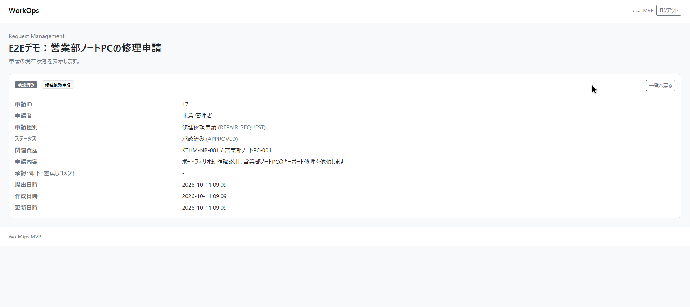
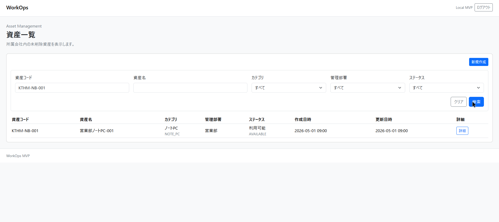
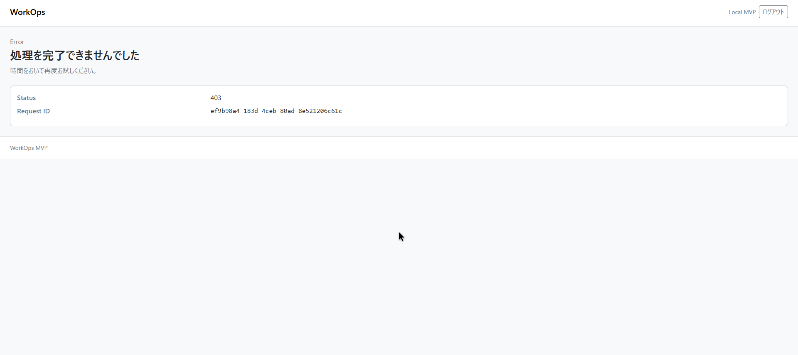
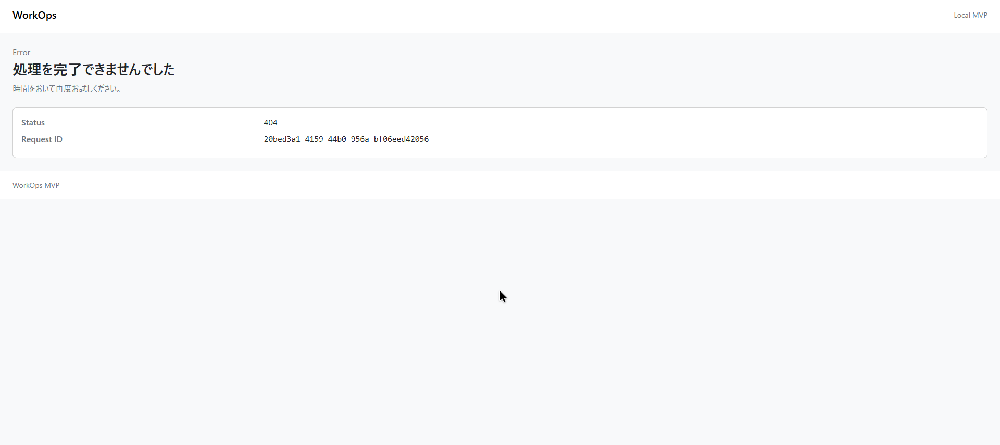

# 利用例・デモ

会社ごとに分かれたデータと権限を使い、申請・資産・管理機能を確認する操作シナリオです。

[セットアップと実行](setup-and-run.md)の手順でMySQLを起動し、Flywayでサンプルデータを投入してからSpring Bootをlocalプロファイルで起動してください。既定ユーザーは北浜精密機器株式会社の管理者です。

## 代表的な利用例

1. 編集者で申請を下書き保存し、提出する。
2. 管理者に切り替えて承認し、申請の状態を確認する。
3. 閲覧者に切り替え、参照と更新の操作可否を確認する。
4. 別会社のユーザーに切り替え、表示される申請・資産が会社ごとに分かれることを確認する。

以下の操作手順は再現方法です。実施済みの検証結果は[テスト](testing.md)にまとめています。

## 実AWSの動作例

CloudFront経由で実Cognitoにログインし、ECS上のアプリからRDSへ保存した画面です。操作と確認は本人の許可を受けたエージェントが実施しています。

| 操作 | 画面で確認できる結果 |
| --- | --- |
| 管理者が申請を保存・提出・承認 | 下書きから提出済み、承認済みへ遷移し、再読込後も状態を保持 |
| 資産コードで検索 | 指定した資産1件を一覧に表示し、詳細へ遷移 |
| 閲覧者が作成URLへ直接アクセス | 参照は可能。作成は403で拒否 |
| 別会社のユーザーが申請URLへ直接アクセス | 自社の申請だけを一覧に表示。他社の申請詳細は404 |

### 申請の保存・提出・承認

[下書き](images/e2e/01-request-draft.png) → [提出済み](images/e2e/02-request-submitted.png) → [承認済み](images/e2e/03-request-approved.png)



### 資産検索



[検索した資産の詳細](images/e2e/05-asset-detail.png)も確認しています。

### 権限と会社境界

閲覧者の[一覧](images/e2e/06-viewer-list.png)と[申請詳細](images/e2e/07-viewer-detail.png)は参照できます。作成URLへの直接アクセスは拒否されます。



別会社の[申請一覧](images/e2e/09-other-tenant-list.png)には自社データだけが表示され、他社の申請詳細は表示されません。



検証対象と確認結果は[テスト](testing.md)に記載しています。

## ユーザー切替

Spring Bootを停止し、同じPowerShellセッションで`WORKOPS_LOCAL_COGNITO_SUB`を設定してから再起動します。

```powershell
$env:WORKOPS_LOCAL_COGNITO_SUB = "00000000-0000-0000-0000-000000000002"
.\mvnw.cmd spring-boot:run "-Dspring-boot.run.profiles=local"
```

| 用途 | cognito_sub | 権限 |
| --- | --- | --- |
| PLATFORM管理者確認 | `00000000-0000-0000-0000-000000000000` | PLATFORM_ADMIN |
| 北浜の閲覧者確認 | `00000000-0000-0000-0000-000000000001` | TENANT_VIEWER |
| 北浜の編集者確認 | `00000000-0000-0000-0000-000000000002` | TENANT_EDITOR |
| 北浜の管理者確認 | `00000000-0000-0000-0000-000000000003` | TENANT_MANAGER |
| 青葉の閲覧者確認 | `00000000-0000-0000-0000-000000000004` | TENANT_VIEWER |
| 青葉の編集者確認 | `00000000-0000-0000-0000-000000000005` | TENANT_EDITOR |
| 青葉の管理者確認 | `00000000-0000-0000-0000-000000000006` | TENANT_MANAGER |

## 申請管理

対象URL

- `/requests`
- `/requests/new`
- `/requests/{id}`
- `/requests/{id}/edit`
- `/requests/{id}/reject`
- `/requests/{id}/remand`

確認シナリオ

1. 編集者で起動し、申請一覧から自社の申請だけが表示されることを確認する。
2. 新規申請を下書き保存し、一覧と詳細に表示されることを確認する。
3. 自分の下書き申請を編集できることを確認する。
4. 下書き申請を提出し、状態が`SUBMITTED`になることを確認する。
5. 自分の提出済み申請を取下げできることを確認する。
6. 管理者で起動し、提出済み申請を承認できることを確認する。
7. 管理者で起動し、提出済み申請を却下し、理由が詳細に表示されることを確認する。
8. 管理者で起動し、提出済み申請を差戻し、理由が詳細に表示されることを確認する。
9. 閲覧者で起動し、申請の参照はできるが作成・更新操作ができないことを確認する。

確認観点

- 編集者は自分の下書きと提出済み申請を操作できる。
- 管理者は提出済み申請を承認、却下、差戻しできる。
- 閲覧者は参照のみできる。
- 他社の申請は一覧、詳細、更新対象に出ない。

## 資産管理

対象URL

- `/assets`
- `/assets/new`
- `/assets/{id}`
- `/assets/{id}/edit`
- `/assets/{id}/status`

確認シナリオ

1. 編集者で起動し、資産一覧から自社の資産だけが表示されることを確認する。
2. 資産コード、資産名、資産分類、管理部署、ステータスで検索できることを確認する。
3. 資産を登録し、一覧と詳細に表示されることを確認する。
4. 登録済み資産を編集できることを確認する。
5. 資産ステータスを変更できることを確認する。
6. 管理者で起動し、資産を論理削除できることを確認する。
7. 閲覧者で起動し、資産の参照はできるが登録・編集・ステータス変更・削除ができないことを確認する。

確認観点

- 削除済み資産は通常の一覧や選択肢に出ない。
- 削除済み資産を参照している親データは表示できる。
- 他社の資産は一覧、詳細、更新対象に出ない。
- 資産コードは同一会社内で重複登録できない。

## マスタ管理

対象URL

- `/masters/request-types`
- `/masters/request-types/new`
- `/masters/request-types/{id}/edit`
- `/masters/asset-categories`
- `/masters/asset-categories/new`
- `/masters/asset-categories/{id}/edit`

確認シナリオ

1. 管理者で起動し、申請種別マスタを登録できることを確認する。
2. 管理者で起動し、申請種別マスタを編集、論理削除、復活できることを確認する。
3. 管理者で起動し、資産分類マスタを登録できることを確認する。
4. 管理者で起動し、資産分類マスタを編集、論理削除、復活できることを確認する。
5. 削除済み表示を有効にし、削除済みマスタ値が一覧に表示されることを確認する。
6. 編集者と閲覧者で起動し、マスタ変更操作ができないことを確認する。

確認観点

- 申請種別と資産分類は会社別に管理される。
- 削除済みマスタ値は新規作成・編集用の選択肢から除外される。
- 削除済みマスタ値を参照している親データは表示できる。
- 削除済みコードは再利用できない。

## ユーザー・権限管理

対象URL

- `/admin/users`
- `/admin/users/new`
- `/admin/users/{id}`
- `/admin/users/{id}/edit`
- `/users`
- `/users/new`
- `/users/{id}`
- `/users/{id}/edit`

確認シナリオ

1. PLATFORM管理者で起動し、`/admin/users`でPLATFORMユーザーと全会社のTENANTユーザーが表示されることを確認する。
2. PLATFORM管理者で起動し、PLATFORMユーザーを作成し、詳細にlocal用のFakeが発行した`cognito_sub`と`PLATFORM_ADMIN`権限が表示されることを確認する。
3. PLATFORM管理者で起動し、任意会社のTENANTユーザーを作成し、詳細にTENANT権限セットが表示されることを確認する。
4. PLATFORM管理者で起動し、会社作成時に初期TENANT_MANAGERを入力し、作成後にユーザー一覧・詳細で確認する。
5. PLATFORM管理者で起動し、ユーザーの表示名、email、所属部署、権限セットを編集できることを確認する。
6. 北浜の管理者で起動し、`/users`で自社TENANTユーザーだけが表示されることを確認する。
7. 北浜の管理者で起動し、自社TENANTユーザーを作成・編集できることを確認する。
8. 北浜の管理者で起動し、他社ユーザー、PLATFORMユーザー、`PLATFORM_ADMIN`権限を扱えないことを確認する。
9. TENANT_MANAGER数が0になる権限変更が拒否されることを確認する。
10. 削除済み部署に所属するユーザーが`部署名（削除済み）`と表示されることを確認する。

確認観点

- `username`、`actor_type`、`company_id`、`cognito_sub`は作成後に変更できない。
- ユーザー作成時はlocalプロファイルではFake Beanが疑似`cognito_sub`を発行し、非localではCognito `AdminCreateUser`境界を使う。
- 通常の自動テストとlocal確認ではAWSへ接続しない。
- 実Cognitoの招待メール送信、実ユーザーログイン、Hosted UI確認はユーザーが手動で実施する。

## 業務操作ログ

確認対象

- 申請操作
- 資産操作
- 申請種別マスタ操作
- 資産分類マスタ操作

確認シナリオ

1. Spring Boot起動中のPowerShellを開いたままにする。
2. 申請、資産、マスタの成功操作を実行し、`com.example.workops.operation`の`SUCCESS`ログが出ることを確認する。
3. 権限不足、状態不一致、不正な参照などの拒否操作を実行し、`REJECTED`ログが出ることを確認する。

確認観点

- ログには`requestId`、`userId`、`companyId`、`actorType`、`authorities`、`operation`、`targetType`、`targetId`、`result`、`reasonCode`、`reasonCommentPresent`、`exceptionType`が出力される。
- `@PreAuthorize`によるアクセス拒否は、認可のセキュリティイベントとして記録し、業務操作ログの対象外とする。
- 業務操作ログはアプリケーションログとして出力する。AWSではCloudWatch Logsで確認する。
