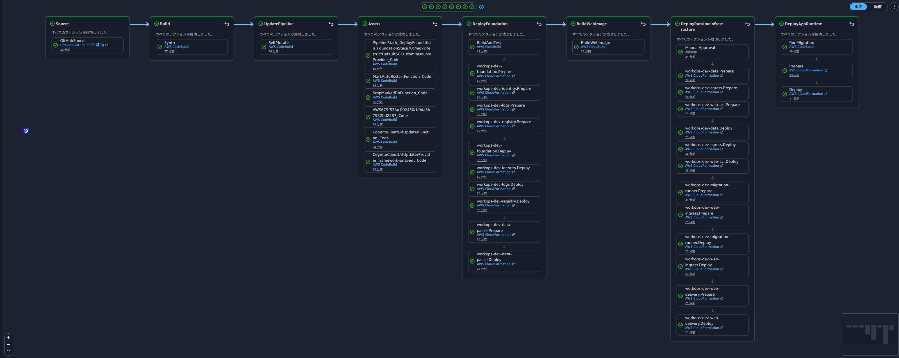

# テスト

実AWSのCloudFront・Cognito・ECS・RDSを使った画面E2Eは4ケース成功しています。Javaテスト388件、CDKテスト31件、コンテナの脆弱性検査も成功しています。

[README](../README.md) · [主要機能](key-features.md) · [セットアップと実行](setup-and-run.md) · [利用例・デモ](example-or-demo.md)

## 確認項目と根拠

| 確認項目 | 期待する動作 | 確認方法・参照先 |
|---|---|---|
| 申請の状態遷移 | 下書き・提出・取下げ・承認・却下・差戻しを権限と状態に応じて扱う | [RequestCommandServiceTests](../apps/web/src/test/java/com/example/workops/request/service/RequestCommandServiceTests.java)、[操作シナリオ](example-or-demo.md#申請管理) |
| 会社境界 | 他社の申請・資産・ユーザー等を参照・更新対象にしない | [RequestMapperIntegrationTests](../apps/web/src/test/java/com/example/workops/integration/RequestMapperIntegrationTests.java)、[AssetMapperIntegrationTests](../apps/web/src/test/java/com/example/workops/integration/AssetMapperIntegrationTests.java)、[UserAdminMapperIntegrationTests](../apps/web/src/test/java/com/example/workops/integration/UserAdminMapperIntegrationTests.java) |
| 認証・認可 | ログイン経路と利用者区分を検査し、権限外の操作を拒否する | [LoginRouteActorTypeTests](../apps/web/src/test/java/com/example/workops/common/security/LoginRouteActorTypeTests.java)、[MethodSecurityPreAuthorizeTests](../apps/web/src/test/java/com/example/workops/common/security/MethodSecurityPreAuthorizeTests.java)、[実AWSの画面E2E](#実awsでの画面e2e) |
| DB制約とサンプルデータ | 制約違反を拒否し、スキーマ・サンプルデータを利用できる | [DatabaseConstraintIntegrationTests](../apps/web/src/test/java/com/example/workops/integration/DatabaseConstraintIntegrationTests.java)、[SeedMigrationIntegrationTests](../apps/web/src/test/java/com/example/workops/integration/SeedMigrationIntegrationTests.java) |
| 業務操作ログ | 成功・拒否の操作と調査用の情報を記録する | [OperationLoggerTests](../apps/web/src/test/java/com/example/workops/common/logging/OperationLoggerTests.java)、[RequestIdMdcFilterTests](../apps/web/src/test/java/com/example/workops/common/logging/RequestIdMdcFilterTests.java) |
| RDS停止APIの再試行 | 対象の一時エラーだけを再試行し、上限超過や対象外エラーを伝える | [data-pause-handler.test.ts](../infra/cdk/test/data-pause-handler.test.ts) |

## 機械的検証の結果

| 検証 | 結果 | 確認方法・補足 |
|---|---|---|
| Javaテスト | 48スイート・388件、失敗・エラー・スキップ各0 | CodeBuildの実行ログ |
| Java品質ゲート | Spotless、SpotBugs、Maven verify成功 | CodeBuildの実行ログ |
| JaCoCo | カバレッジ基準を達成 | CodeBuildの実行ログ。カバレッジ率は未掲載 |
| CDK品質ゲート | ビルド・lint・整形チェック成功。Jestは10スイート・31件、Python unittestは2件成功 | CodeBuildの実行ログ |
| CDK Synth | ビルド・synthを実行し、BUILDフェーズ成功 | CodeBuildの実行ログとAPI応答 |
| Webイメージ | ARM64イメージのbuild / scan / push成功。TrivyのMEDIUM/HIGH/CRITICAL検出はOS・Javaともに0件 | CodeBuildの検査レポートを確認。検査したイメージとECSで稼働するイメージの一致も確認 |
| 実行基盤 | RDS available、ECS RUNNING 1 / PENDING 0、CloudFront経由でログイン・業務画面を表示 | AWS API、起動ログ、ブラウザ操作 |

## AWS CI/CD

GitHubの`dev`へのpushを起点に、ビルド・テスト・脆弱性検査・インフラ更新・DBマイグレーション・ECSへのデプロイまで、CodePipelineの全8ステージが成功しています。



## 実AWSでの画面E2E

本人の許可を受けたエージェントが、実Cognitoログインと業務操作を実行しました。

| ケース | 操作と結果 | 証跡 |
| --- | --- | --- |
| 1. 申請の保存・提出・承認 | 北浜の管理者で作成。DRAFT → SUBMITTED → APPROVED。再読込後も承認済みを保持 | [下書き](images/e2e/01-request-draft.png)、[提出済み](images/e2e/02-request-submitted.png)、[承認済み](images/e2e/03-request-approved.png) |
| 2. 資産検索・詳細 | KTHM-NB-001で1件を検索し、資産名・管理部署・状態を詳細で確認 | [検索結果](images/e2e/04-asset-search.png)、[詳細](images/e2e/05-asset-detail.png) |
| 3. 閲覧者の権限 | 北浜の閲覧者で参照可能。新規作成導線は非表示。作成URLへの直接アクセスは403 | [一覧](images/e2e/06-viewer-list.png)、[詳細](images/e2e/07-viewer-detail.png)、[403](images/e2e/08-viewer-403.png) |
| 4. 会社境界 | 青葉の閲覧者には自社申請だけ表示。北浜の申請詳細への直接アクセスは404 | [青葉の一覧](images/e2e/09-other-tenant-list.png)、[404](images/e2e/10-other-tenant-404.png) |

CloudWatch Logsで申請の作成・提出・承認、認証成功、権限拒否、404の記録を確認しています。403・404画面のRequest IDは対応するログと一致しています。

スクリーンショット10枚は`docs/images/e2e/`に保存しています。動画は申請・資産操作、閲覧者の権限、会社境界の3本を取得しています。

## 自分でテストする

Java 25とDocker Desktopを用意します。MySQL Mapper統合テストにはTestcontainersを使います。Dockerが利用できない場合は統合テストがスキップされる場合があるため、実行結果のスキップ数も確認してください。

```powershell
cd C:\git\workops\apps\web
.\mvnw.cmd spotless:check
.\mvnw.cmd compile spotbugs:check
.\mvnw.cmd verify
```

JaCoCoのカバレッジチェックは`verify`フェーズで実行します。テストのみを実行する場合は`.\mvnw.cmd test`を使います。

CDKは依存を準備した環境で次を順に実行します。これらはローカルの品質チェックです。

```powershell
cd C:\git\workops\infra\cdk
npm run build
npm run test
npm run lint
npm run format:check
```

CDK synthの環境設定は[セットアップと実行](setup-and-run.md#awsセットアップと実行)を参照してください。DB初期化と画面操作の再現は[利用例・デモ](example-or-demo.md)にあります。

## CloudWatch Logsの確認

AWSでのログ確認は本人が行います。[AWS接続先の設定](setup-and-run.md#awsの前提ツール)でprofile、region、認証先を確認してから、Webのロググループと最新のログストリームを調べます。

```powershell
aws logs describe-log-groups --profile $env:AWS_PROFILE --region $env:AWS_REGION --log-group-name-prefix "/workops/$env:WORKOPS_SOURCE_BRANCH"
aws logs describe-log-streams --profile $env:AWS_PROFILE --region $env:AWS_REGION --log-group-name "/workops/$env:WORKOPS_SOURCE_BRANCH/web" --order-by LastEventTime --descending --max-items 20
```

CloudWatch Logs InsightsでWebのロググループと確認対象の時間帯を選び、次のクエリでリクエストごとのログを確認します。

```text
fields @timestamp, @logStream, @message
| filter @message like /requestId=/
| sort @timestamp desc
| limit 50
```

目的に応じて`filter`を以下の条件に置き換えます。

| 確認対象 | 検索条件 | 確認する内容 |
| --- | --- | --- |
| 認証成功・拒否 | `@message like /eventType=AUTHENTICATION_/` | 成功または拒否と理由が記録される |
| 利用者の紐付け | `@message like /reasonCode=USER_NOT_LINKED/` | Cognito利用者と業務DB利用者を紐付けられない場合の理由 |
| ログイン経路の不一致 | `@message like /reasonCode=ACTOR_TYPE_MISMATCH/` | Platform / Tenantの利用者区分が一致しない場合の理由 |
| 権限外の操作 | `@message like /eventType=AUTHORIZATION_DENIED/` | 操作を拒否した記録 |
| アプリケーション例外 | `@message like /eventType=APPLICATION_EXCEPTION/` | HTTPステータスと対象パス、リクエストID |
| 業務操作 | `@message like /com.example.workops.operation/` | 操作対象と成功・拒否の結果 |

## 確認結果の範囲

画面E2Eは上記の4ケースです。カバレッジ率とFlywayの詳細実行結果は掲載していません。

学習用構成の可用性、内部通信、WAF、性能・復元測定等の扱いは[コード・設計](code-and-design.md#学習用構成の制約)にまとめています。
